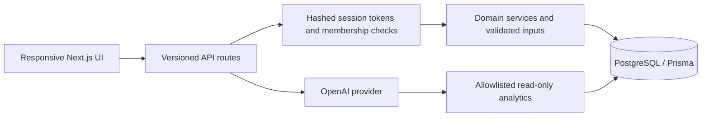
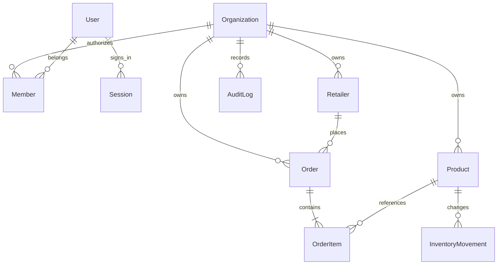
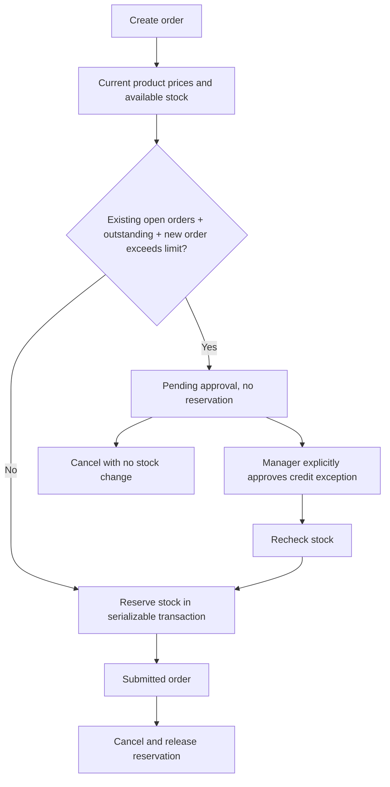
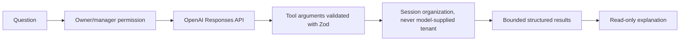

# Drinkarto architecture

This repository is the first working foundation and core operations slice of the supplied product specification. It is not a production launch of the entire specification.

## System

## Tenant model

Every resource query binds organizationId from the verified session membership. API schemas reject organizationId supplied by callers. Composite primary and foreign keys prevent orders and movements from referencing products or retailers from another tenant. Organizations are separate business workspaces, not separately provisioned databases. PostgreSQL row-level security is not yet implemented; query-level isolation and database foreign keys are the current layers.

## Orders

Transactions write inventory movements and audit records together. Database checks disallow negative quantities, over-reservations and unknown states. Concurrency conflicts return 409 and require the caller to refresh before retrying; no silent retry of a financial write occurs. Repeated cancellation or approval of an already transitioned order is rejected.

## Authentication and roles

Password hashes use bcrypt, input passwords are 12–72 characters. Random 256-bit session tokens are stored only as SHA-256 hashes. Cookies are HttpOnly, SameSite=Lax, and Secure in production. All writes require an exact configured Origin. Login/signup attempts are limited to ten per normalized email per 15 minutes. This does not yet provide comprehensive IP abuse protection or verified email ownership.

OWNER can manage current resources. MANAGER can create retailers, adjust stock, create and approve/cancel orders. WAREHOUSE can read products and adjust stock. SALES can read products; assigned-retailer reads and scoped order creation are not yet implemented, so order creation is denied for this role. ACCOUNTS can sign in but finance workflows are pending. Owner/manager-only reads include retailer data, analytics, orders and audit. There is no public role assignment endpoint yet. Unknown roles fail closed.

## AI

Tools: getOrderSummary (1–366 recent days), getInventoryStatus (100 rows maximum), getRetailerCount, getPendingApprovals, and getInvoiceBalances (latest 100 invoices). No tool accepts SQL, a tenant identifier, or business writes. No contact details, licence documents or passwords are included. User questions and scoped tool results are sent to OpenAI; responses are requested with store=false. Drinkarto persists AI transcripts in PostgreSQL by organization and creating member; only that member can retrieve or delete their conversations. Up to 12 prior user/assistant messages are supplied as context. This setting disables Responses application-state storage, not provider safety logging. Recommendations remain advisory. There is no RAG or forecasting in this slice. Model defaults to gpt-6-luna and is configurable.

Provider references: [function calling](https://developers.openai.com/api/docs/guides/function-calling), [models](https://developers.openai.com/api/docs/models). Prisma follows its [v7 client configuration](https://www.prisma.io/docs/orm/prisma-client/setup-and-configuration/introduction); Next.js follows the [installation guide](https://nextjs.org/docs/app/getting-started/installation).

## Next phases

1. Team invitations, email verification/reset, optional 2FA, organization switching, configurable permissions and salesperson retailer assignment.
2. Warehouses, batches, order fulfilment/dispatch/returns, invoice and payment ledgers, tax configuration and credit policy settings.
3. Compliance documents and expiry reminders; report exports; job queue and object storage.
4. Subscriptions and limits, retailer portal, accounting adapters and platform administration.
5. RAG with tenant/permission filters and forecasting after clean transaction history exists.
6. Production hardening: RLS, idempotency keys, distributed rate limits, observability, backup/restore drills, E2E suite and deployment validation.

No GPS, location tracking or route optimization is implemented or planned.
